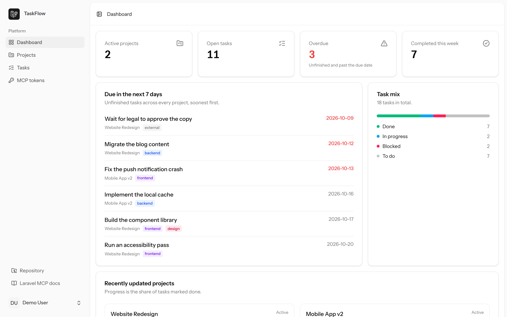
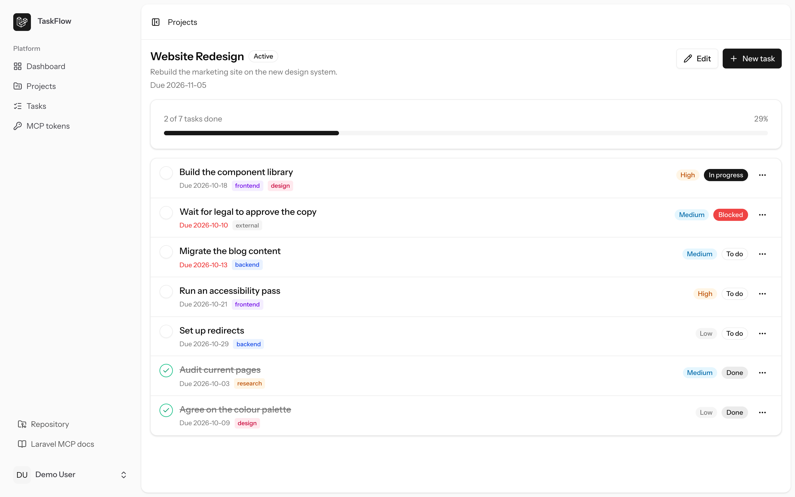
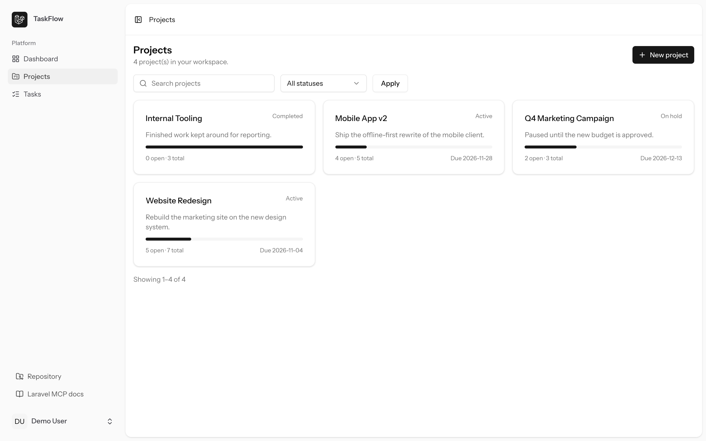
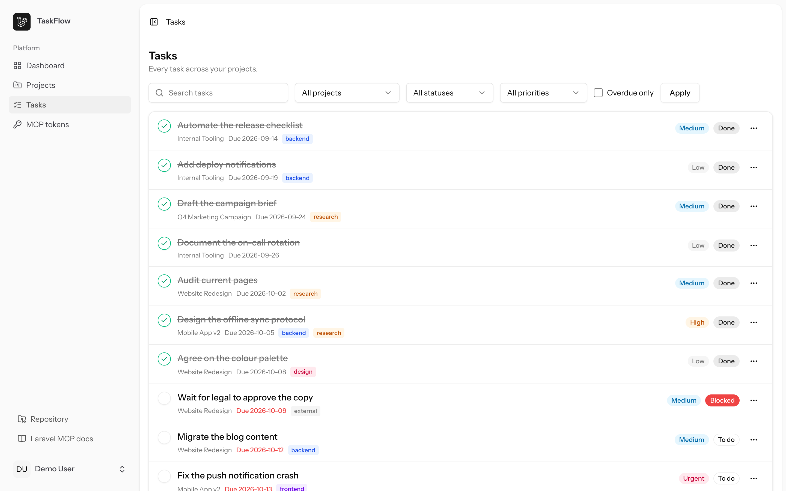
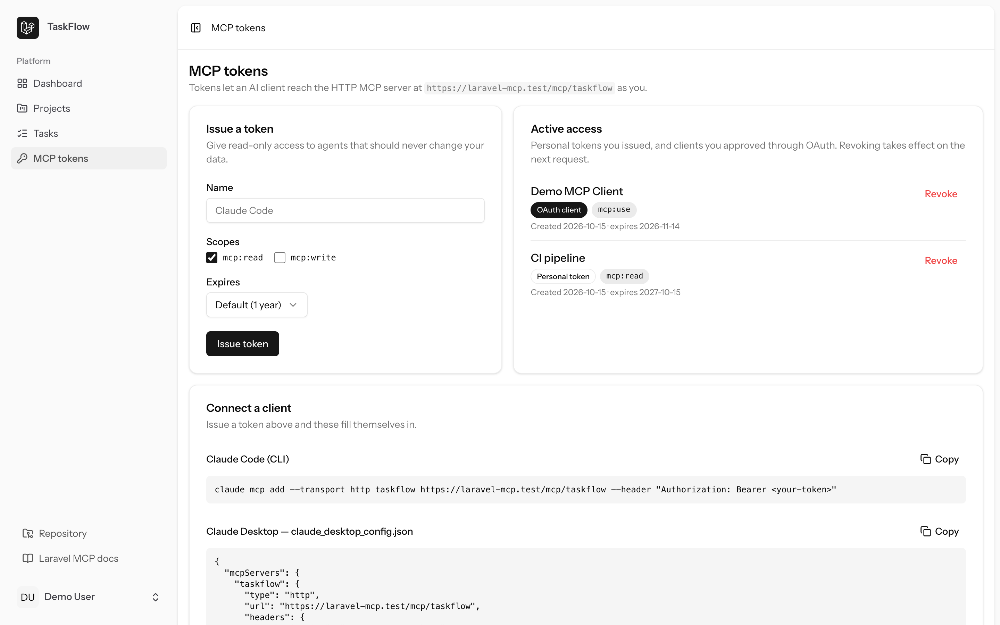
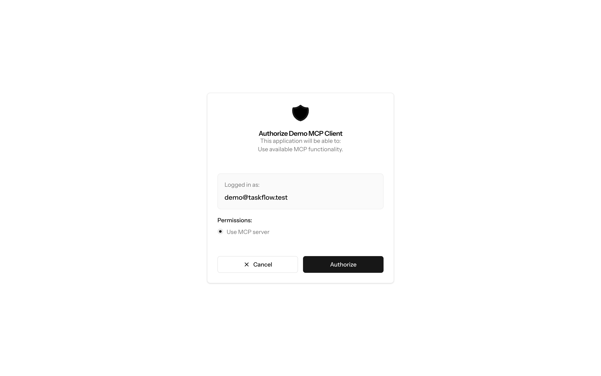

# TaskFlow — a Laravel app that AI agents can actually use

[](https://github.com/RilindArifi/laravel-mcp/actions/workflows/tests.yml)


TaskFlow is a small project and task tracker built on the Laravel 13 Vue starter
kit — and the same domain is exposed to AI agents over the
[Model Context Protocol](https://laravel.com/docs/mcp) with the official
`laravel/mcp` package.

- **A real Laravel app.** Projects, tasks and labels with Eloquent relationships,
  policies, form requests, an Inertia + Vue 3 UI and 95 tests.
- **The same domain, two front doors.** Everything the browser can do, an agent
  can do: 10 tools, 3 resources (including a URI template) and 2 prompts.
- **Real OAuth 2.1.** Remote clients register themselves, the user approves a
  consent screen, and the token is never copied by hand — Passport fronts the
  HTTP endpoint, with personal access tokens for scripts.
- **Authorization written once.** Relationship-scoped queries plus the same
  policies guard both doors, so an agent is simply another authenticated client.

## Screenshots

| Dashboard                                    | Project detail                                         |
| -------------------------------------------- | ------------------------------------------------------ |
|  |  |

| Projects                                   | Tasks                                |
| ------------------------------------------ | ------------------------------------ |
|  |  |





## The MCP server

`app/Mcp/Servers/TaskFlowServer.php` is registered twice in `routes/ai.php`:
over stdio for editor agents, and over HTTP for remote clients.

```php
Mcp::local('taskflow', TaskFlowServer::class);

Mcp::web('/mcp/taskflow', TaskFlowServer::class)
    ->middleware(['auth:sanctum', 'throttle:mcp'])
    ->name('mcp.taskflow');
```

### Tools

| Tool                       | Annotations | What it does                                                   |
| -------------------------- | ----------- | -------------------------------------------------------------- |
| `list-projects`            | read-only   | Projects with task counts and progress                         |
| `create-project`           | —           | Creates a project for the authenticated user                   |
| `update-project`           | idempotent  | Renames, re-statuses or re-schedules a project                 |
| `delete-project`           | destructive | Deletes a project and its tasks                                |
| `list-tasks`               | read-only   | Filter by project, status, priority, overdue, due window, text |
| `create-task`              | —           | Adds a task, creating any new labels on the fly                |
| `update-task`              | idempotent  | Title, description, status, priority, due date                 |
| `complete-task`            | idempotent  | Ticks a task off or reopens it                                 |
| `delete-task`              | destructive | Deletes a task                                                 |
| `generate-progress-report` | read-only   | Streams `processing/progress` notifications, then the report   |

### Resources and prompts

- `taskflow://workspace/overview` — the dashboard counters as JSON, from the same
  `WorkspaceStats` class the dashboard uses.
- `taskflow://projects/{projectId}/summary` — a **URI template** that renders one
  project as markdown.
- `taskflow://docs/conventions` — what each status and priority means, and which
  tool to reach for. The only publicly cacheable primitive, because it is the
  only one that contains no user data.
- `weekly-review` and `plan-project` prompts, which drive multi-tool workflows.

## Run it locally

```bash
composer setup   # installs, generates the app and Passport keys, migrates, seeds, builds
npm run dev
```

`composer setup` creates `storage/oauth-*.key` for Passport (gitignored, as they
should be) and the seeder creates the personal access client that the tokens
page issues from.

Sign in with **demo@taskflow.test** / **password**. The seeder also creates a
second user (`ada@taskflow.test`) whose work must never be visible to the demo
user — that is what the scoping tests assert.

## Connect an MCP client

### Over OAuth 2.1 — nothing to copy (recommended)

Point the client at the server and let it do the rest: it reads
`/.well-known/oauth-protected-resource`, registers itself through dynamic client
registration, sends you to a consent screen, and exchanges the code with PKCE.

```bash
claude mcp add --transport http taskflow https://laravel-mcp.test/mcp/taskflow
```

Approve the screen in the browser and the client is connected. The grant is
listed on the **MCP tokens** page and can be revoked there.

### Over a personal access token — for scripts and CI

```bash
php artisan mcp:token demo@taskflow.test --name="CI" --scopes=mcp:read
```

Or issue one from the **MCP tokens** page, which also fills in three copy-ready
snippets with it. Send it as a bearer token:

```json
{
    "mcpServers": {
        "taskflow": {
            "type": "http",
            "url": "https://laravel-mcp.test/mcp/taskflow",
            "headers": { "Authorization": "Bearer ${TASKFLOW_MCP_TOKEN}" }
        }
    }
}
```

> **Local TLS gotcha.** Herd's certificate is trusted by macOS (so `curl` works)
> but not by Node's bundled CA list, so a client may fail with
> `UNABLE_TO_VERIFY_LEAF_SIGNATURE`. Either point Node at Herd's CA:
>
> ```bash
> export NODE_EXTRA_CA_CERTS="$HOME/Library/Application Support/Herd/config/valet/CA/LaravelValetCASelfSigned.pem"
> ```
>
> or skip TLS entirely with `php artisan serve` and use
> `http://127.0.0.1:8000/mcp/taskflow`.

### Over stdio (Claude Code, Cursor, …)

On the machine that runs the app, skip URLs, tokens and certificates entirely:

```bash
claude mcp add taskflow -- php /absolute/path/to/laravel-mcp/artisan mcp:serve --user=demo@taskflow.test
```

`mcp:serve` picks the user the server acts as, then starts the stdio transport.
`cp .mcp.json.example .mcp.json` has the same thing in file form.

### Inspect it

```bash
php artisan mcp:inspector taskflow      # the stdio server
php artisan mcp:inspector mcp/taskflow  # the HTTP server (keyed by route URI)
```

## How authorization works

Three layers, in this order:

1. **Relationship-scoped lookups.** Tools resolve ids through `$user->projects()`
   and `$user->tasks()`, so another user's row comes back as `null` and is
   reported as _not found_ — never as _forbidden_. The tools cannot be used to
   probe for rows that are not yours.
2. **Scoped validation.** `create-task` validates `project_id` with
   `Rule::exists('projects', 'id')->where('user_id', $user->id)`, with an error
   message that tells the model to call `list-projects` first.
3. **The same policies as the web UI.** Every mutating tool runs
   `Gate::forUser($user)->authorize(...)` against `ProjectPolicy` / `TaskPolicy`.

On the HTTP transport, Passport decides who the caller is and what it may do.
The OAuth flow grants the `mcp:use` scope, which is full access; a personal
access token can be narrowed to `mcp:read`, and every write tool refuses it with
_"This MCP token is read-only."_ `throttle:mcp` rate-limits per user.

The stdio transport is honest about what it is: `mcp:serve --user=` is an
identity selector for local development, not a security boundary — anyone who can
run `artisan` already has database access. It refuses to run in production.

## Architecture

```
app/Mcp/
├── Servers/TaskFlowServer.php      # name, version, agent instructions, registry
├── Tools/                          # 10 tools
├── Resources/                      # workspace overview, project summary template, conventions
├── Prompts/                        # weekly-review, plan-project
├── Concerns/InteractsWithTaskFlowUser.php  # user resolution + scoping + token abilities
└── Support/LocalUserResolver.php   # stdio identity, refused in production

app/Support/
├── WorkspaceStats.php              # one source for the dashboard and the MCP overview
└── TaskFlowPayload.php             # one shape for Inertia props and structured content

app/Http/Controllers/Mcp/TokenController.php  # the MCP tokens module (issue, list, revoke)
resources/js/pages/mcp-tokens/Index.vue
routes/ai.php                        # Mcp::oauthRoutes() + the two transports
```

Deliberate omissions, with reasons:

- **No `ToolSearch` catalog.** Ten tools fit comfortably in any client's tool
  list; a searchable catalog starts paying off past roughly thirty.
- **No published `config/mcp.php`.** This server uses no OAuth, no outgoing
  clients and no tool-search limits, so publishing it would only add dead config.
- **No `#[Cacheable]` on user-scoped primitives.** Only the static conventions
  resource is publicly cacheable.

## Tests

```bash
php artisan test              # 95 tests
php artisan test --filter=Mcp # the MCP layer only
composer ci:check             # lint, types, phpstan level 7, tests — what CI runs
```

The tests that carry the most weight are the scoping ones: `list-projects` does
not see another user's project, id-taking tools report it as missing, labels are
never shared between users, and `POST /mcp/taskflow` is unauthorized without a
token.

## What I would do next

- Queue the progress report once a workspace is large enough for it to be slow.

## License

MIT.
